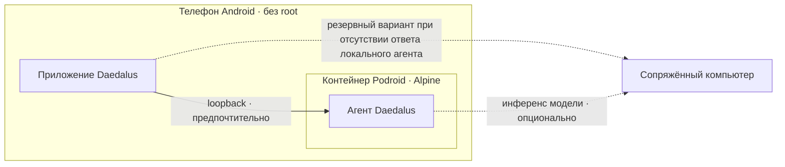
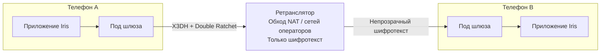
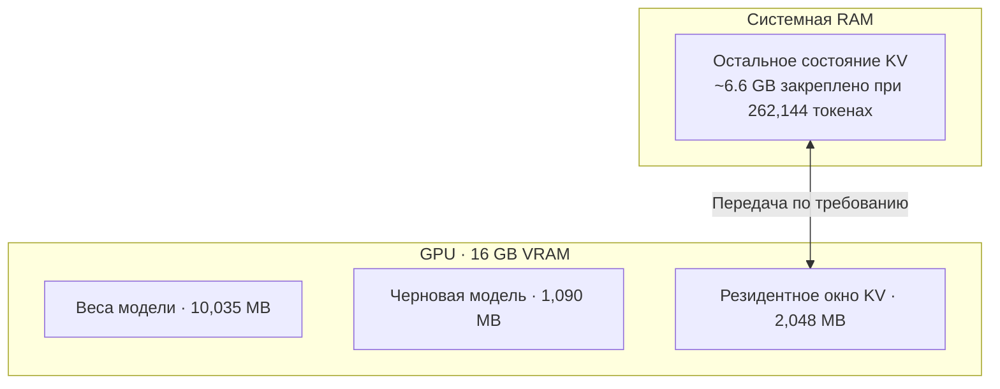
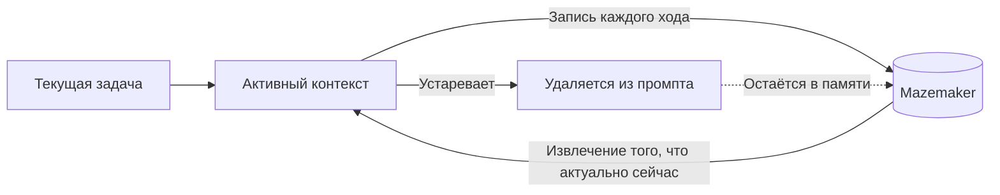
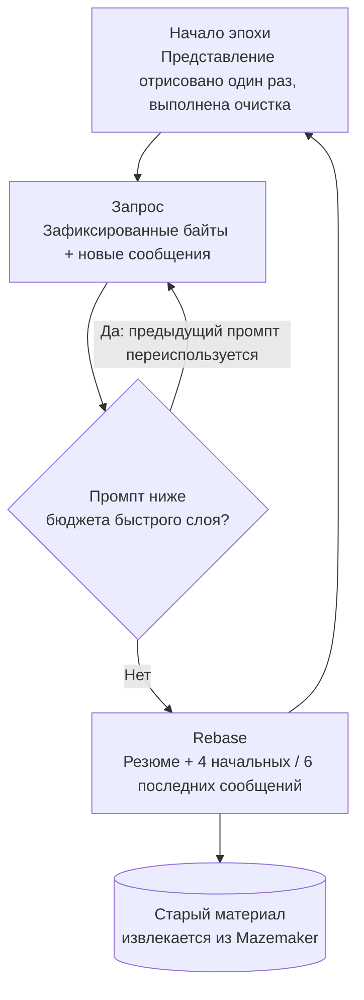
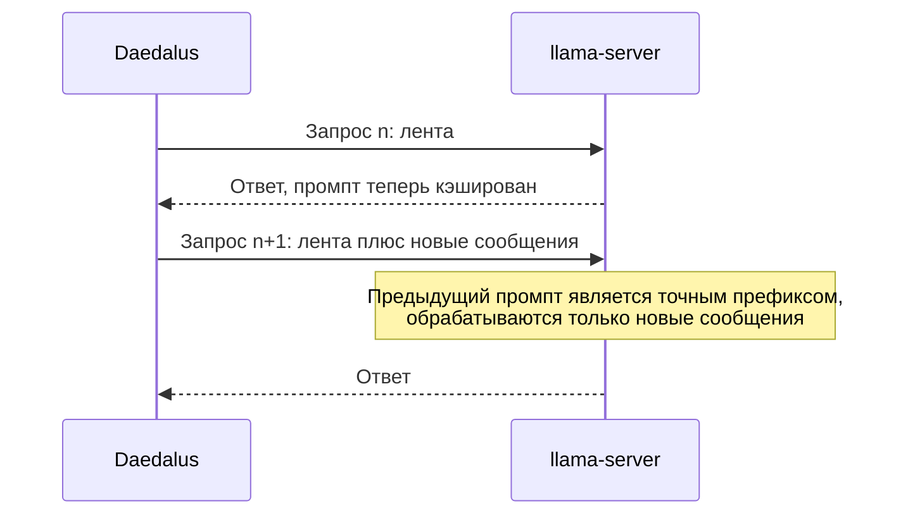
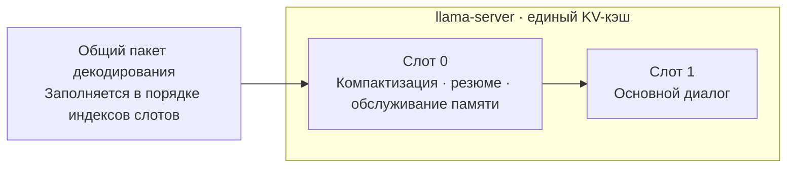
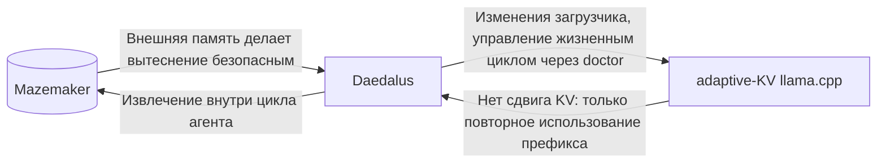
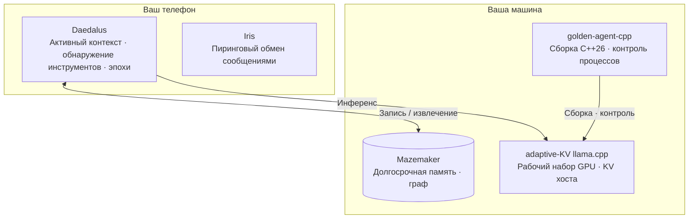

# Daedalus

Daedalus — это ИИ-агент, архитектура которого построена вокруг двух ограничений:

- модель не должна переносить всю историю взаимодействия в каждом запросе;
- система должна оставаться работоспособной на потребительском оборудовании.

> **Кратко**
>
> - Daedalus запускает плотную модель 27B с контекстом в 262 144 токена на потребительской видеокарте с 16 ГБ памяти.
> - Активное окно KV-кэша находится в памяти GPU; остальное состояние KV передаётся из системной RAM по мере необходимости.
> - Агент намеренно не переносит всю свою историю. Mazemaker хранит её и обеспечивает извлечение.
> - Между точками компактизации промпт работает в режиме append-only, сохраняя повторное использование префикса вместо постоянного пересоздания середины диалога.
> - Описания инструментов и навыков обнаруживаются по мере необходимости, а не вставляются в каждый запрос.
> - Агент работает на телефоне. Не существует центрального сервиса Daedalus, который хранит его данные.
> - Его драйвер был самостоятельно перенесён агентом с Python на C++26 прямо во время эксперимента.
>
> Далее в документе описывается работа этих компонентов и измерения, лежащие в основе архитектуры.

---

## Локальность как основа архитектуры

### Агент находится на устройстве

Daedalus может работать на Android без root-доступа. Podroid предоставляет среду выполнения контейнеров, внутри которой запускается Alpine, а в ней — сам агент. Когда приложение отвечает, оно взаимодействует с локальным агентом через loopback и обращается к сопряжённому настольному компьютеру только в том случае, если локальный агент не отвечает. При этом сама модель всё ещё может выполняться на сопряжённой машине.



**Агент локален для устройства. Модель не обязана быть локальной.**

### Данные больше негде хранить

Не существует центрального сервиса Daedalus, который хранит данные агента: ни учётной записи, ни серверной копии, которую можно было бы утечь, продать или передать третьим лицам. Это архитектурное решение, а не обещание, данное в политике конфиденциальности. Оно было зафиксировано ещё до начала разработки: [On Local-First Data Sovereignty](https://mazemaker.online/manifesto/), апрель 2026 года, без изменений с момента публикации.

### Iris: тот же принцип, применённый к обмену сообщениями

[Iris](https://iris.mazemaker.online) — это зашифрованный пиринговый мессенджер, шлюз которого работает на вашем телефоне. Без учётной записи. Без центрального сервера. Ни одна компания не читает ваши сообщения, потому что не существует сервера, с которого их можно было бы прочитать.

Iris напрямую соединяет два телефона. Каждый запускает собственный шлюз — небольшой Linux-под, работающий непосредственно на устройстве через Podroid. Сообщения шифруются с использованием семейства протоколов, применяемого Signal (X3DH + Double Ratchet), ещё до того, как покидают телефон. Ретранслятор существует исключительно для обхода NAT и ограничений операторских сетей: он пересылает непрозрачный шифротекст и не может прочитать ни слова.



Iris поставляется в составе **The Box**. Изначально его вообще не было в плане: проект появился как побочный продукт обходного решения и развивался параллельно с Daedalus, а не после него.

Daedalus и Iris объединяет одно правило: **размещать состояние настолько близко к конечному устройству, насколько это практически возможно, и позволять инфраструктуре между конечными точками знать как можно меньше.**

---

## Оборудование и инференс

Эталонная конфигурация использует одну RTX 4060 Ti с 16 ГБ видеопамяти:

```text
NVIDIA RTX 4060 Ti · 16 GB

основная модель      10,035 MB   Qwen3.8-27B dense
черновая модель       1,090 MB   DFlash2 Q4_K_M
резидентный пул KV    2,048 MB
движок памяти           300 MB   222,409 memories / 1,500,622 connections

остаток               ~2.9 GB   CUDA context, compute buffers, display
```

Измеренная скорость генерации составляет в среднем приблизительно 27 токенов/с, отдельные запуски достигают примерно 40 токенов/с.

Главное ограничение заключается не только в весах модели. Это KV-кэш.

Для данной модели не-квантованное представление KV занимает приблизительно 73 КБ на токен, поэтому контекст в 262 144 токена требует около 19 ГБ только для состояния KV:

```text
веса модели          ~10 GB
KV для 262k токенов  ~19 GB
                     ------
                     ~29 GB     на карте с 16 GB
```

Поэтому Daedalus оставляет на GPU только текущее активное окно KV. Остальная часть находится в оперативной памяти хоста и передаётся по мере необходимости с использованием [адаптивного KV-форка llama.cpp](https://github.com/RaymondHuang210129/llama.cpp-adaptive-kv-streaming).



Контекст по-прежнему использует полное внимание. Старая история диалога не заменяется резюме только потому, что весь контекст не помещается в VRAM.

---

## Контекст — это ресурс

Большое контекстное окно само по себе не делает агента эффективным. Агент может иметь сотни инструментов, навыков и тысячи сообщений, хотя для текущей операции актуальна лишь малая их часть. Включение всего этого в каждый запрос расходует контекст, не добавляя информации.

Daedalus рассматривает содержимое промпта как ресурс, который необходимо отбирать. Результаты измерений одной сессии:

| Материал | До | После |
|---|---:|---:|
| Каталог навыков | 24 470 токенов | 329 токенов |
| Контекст рабочей сессии | 70 397 токенов | 8 967 токенов |

На каталог навыков приходилась большая часть исходного контекста, хотя для выполнения операции не потребовалась ни одна из его записей.

- **Инструменты обнаруживаются по мере необходимости.** В активном окне находятся 18 инструментов из 91 существующего. Остальные обнаруживаются тогда, когда нужны.
- **Каталоги подвергаются поиску.** Полный набор навыков остаётся доступным без необходимости сериализовать каждое описание в каждом промпте.
- **Старое состояние покидает активный контекст.** Рассуждения агента записываются в Mazemaker при первой же отправке. Когда они устаревают, их удаляют из промпта — без временных файлов, без путей — и извлекают снова, если они становятся актуальными. Только при недоступности движка памяти происходит переход на хранение на диске.
- **Старые результаты работы инструментов превращаются в ссылки.** Завершённый обмен с инструментом заменяется одной строкой с указанием вызова; если результат снова понадобится, агент повторно выполняет этот вызов.
- **Диалог выносится во внешнее хранилище.** Каждый ход записывается в Mazemaker по мере его выполнения.

Daedalus не решает проблему долгосрочной памяти путём постоянного увеличения промпта. **Без бэкенда памяти это намеренное забывание без возможности извлечения.**

Mazemaker — не факультативная оптимизация данной архитектуры, а уровень хранения данных, благодаря которому вытеснение контекста становится практически применимым. Если вы не собираетесь запускать его, используйте другого агента.

---

## Mazemaker

Эталонный экземпляр системы памяти содержит **222 409 воспоминаний и 1 500 622 связи**. Публичное тестирование включает отрицательные контрольные проверки:

| Измерение | Результат |
|---|---:|
| LongMemEval R@5 · 500 вопросов, 25k haystack | 0.8426 |
| LongMemEval R@10 | 0.9000 |
| Двухэтапное рассуждение R@10 | 0.00 → 1.00 |
| `gemma3:270m` на Raspberry Pi | 18/20 |

Для данной архитектуры наиболее важен результат двухэтапного рассуждения: он измеряет извлечение связанной информации, чего не может обеспечить плоский индекс ближайших соседей.

Полные заметки: [Inception Benchmarking](https://mazemaker.online/blog/inception-benchmarking/).



Цель не в том, чтобы удерживать всё в промпте. Цель — сохранять то, что полезно сейчас, и обеспечивать возможность восстановить остальное.

---

## Использование модели

Эталонный агент использует `Qwen3.8-27B` — плотную модель с 27 миллиардами параметров: все 27B параметров участвуют в обработке каждого токена. Модель квантована приблизительно до трёх бит на вес с помощью [GSQ-RCO от ISTA-DASLab](https://huggingface.co/ISTA-DASLab/Qwen3.8-27B-GSQ-RCO-GGUF). Именно это позволяет плотной модели такого размера сосуществовать с большим контекстом на эталонном GPU.

В отдельном эксперименте использовалась `Qwen3.6-35B-A3B` — модель типа mixture-of-experts с приблизительно 3B активных параметров на токен, в формате `IQ3_XXS`. Она сгенерировала с нуля анимированную страницу WebGL объёмом 682 строки приблизительно за 40 000 токенов:

[mazemaker.online/wall-of-shame](https://mazemaker.online/wall-of-shame).

Смысл не в том, что квантование ничего не стоит или что маленькие модели эквивалентны большим. Он гораздо уже: **накладные расходы промпта могут составлять значительную часть рабочей нагрузки агента, и их устранение меняет возможности данной модели без изменения самой модели.**

---

## Контролируемое сравнение

Одна и та же модель, одна и та же задача, одна и та же машина.

`Qwen3.6-35B-A3B` попросили создать браузерную игру Snake в двух разных агентских окружениях. Оба варианта создали работающую игру.

| | Обычное окружение | Daedalus |
|---|---:|---:|
| Использовано контекста | 25.7K / 256K | 9.4K / 262K |
| Результат | Работающая игра | Работающая игра |

Daedalus завершил задачу за два вызова, использовав приблизительно на 63% меньше контекста.

Это имеет практическое значение: при длительной работе перенос исторического материала делает объём полезной работы, помещающейся в контекст, всё более зависимым от управления промптом. Daedalus вместо этого рассматривает активный контекст как рабочий набор.

---

## Длительная работа

Агент, основанный на транскрипте, рано или поздно должен решить, что делать со своим старейшим материалом: продолжать увеличивать контекст, суммировать, обрезать или пересобирать укороченную историю при каждом запросе. Каждый вариант имеет собственную стоимость.

Daedalus использует другую границу:

1. отрисовать диалог один раз;
2. сохранить полученные байты как последовательность append-only;
3. повторно использовать этот префикс в каждом последующем запросе;
4. выполнить rebase активного окна, когда оно достигает установленного бюджета;
5. удалить то, что больше не относится к активному окну;
6. извлечь это из Mazemaker, если материал снова станет актуальным.



Это важно, поскольку эталонный inference-сервер не может сдвигать живой KV-кэш модели. Ротационное позиционное кодирование модели нельзя сдвигать, а её рекуррентная часть допускает усечение только с конца. Поэтому кэш можно повторно использовать только тогда, когда предыдущий промпт является точным префиксом следующего, а не когда была отредактирована секция в середине диалога.

---

## Лента

Предыдущая реализация постоянно редактировала середину диалога, чтобы удалять устаревшие рассуждения, сворачивать вызовы инструментов и отбрасывать устаревшие результаты. Каждое редактирование нарушало префикс.

Измеренные результаты выглядели следующим образом:

```text
повторно использовано на вызов    12,363 токенов    только system prompt и схемы инструментов
с момента запуска сервера        395,333 токенов промпта обработано
                                  161,744 токенов повторно использовано
время                             801 s обработка промпта
                                  587 s генерация
```

Агент тратил больше времени на повторное чтение собственного промпта, чем на написание ответов.

Новая реализация рассматривает запрос как ленту. Сообщение отрисовывается один раз; каждый последующий запрос повторно использует те же самые байты. Очистка контекста происходит на границе rebase, а не при каждом вызове.

Бюджет определяется быстрым слоем, а не размером контекстного окна. KV streaming сохраняет фиксированное число страниц по 256 токенов на каждом слое GPU — 157 страниц при stage 1,024 MiB, что составляет приблизительно 40 200 токенов. При едином KV-кэше оба слота используют эти страницы совместно.

После этого сервер начинает перемещать страницы в системную RAM, и скорость декодирования падает:

- 30–35 t/s при объёме до ~33k токенов;
- 16–22 t/s при 45–48k токенов.

Поэтому rebase выполняется на отметке 32 000 токенов, а подготовка резюме начинается при 60%, чтобы задача суммирования и диалог по-прежнему помещались одновременно.

Увеличение stage пропорционально повышает все эти значения.



В двадцати синтетических тестовых вызовах:

```text
предыдущий подход    17 нарушений префикса
подход с лентой       0 нарушений префикса
```

`context.payload_tape: false` восстанавливает прежнюю отрисовку при каждом вызове.

Ограничение сервера стало частью архитектуры агента вместо того, чтобы оставаться проблемой, которую постоянно обходило окружение.

---

## Управление контекстом

Каждое настроенное значение является измерением на эталонной машине, а не универсальным значением по умолчанию. При переходе на другую конфигурацию GPU, CPU или памяти компромиссы меняются.

| Параметр | Эталонное значение | Причина |
|---|---:|---|
| KV pool | 2048 MB | Объём, который помещается рядом с весами на карте с 16 GB |
| Context | 262,144 | ~6.6 GB закреплённой RAM хоста, постоянное резервирование на весь срок жизни процесса |
| Rebase | 32,000 токенов | Объём резидентного окна KV: страницы по 256 токенов, 157 на слой при stage 1,024 MiB ≈ 40,200 токенов, общих для обоих слотов; подготовка начинается при 60% |
| Rebase keeps | 4 head · 6 tail | Достаточно мало, чтобы освободить место для следующей эпохи; старый материал извлекается, а не переносится |
| Thinking budget | 12,000 | Измеренные ответы составляют от 150 до 2,400 токенов |
| KV cache | K=`q8_0`, V=`q4_0` | K чувствительнее V к точности внимания; ~25 KB/токен при этих настройках |
| Draft | Q4_K_M | Стандартный спекулятивный декодер |
| Draft under heavy load | Q2 | Снижение стоимости черновой модели, когда доминирует нагрузка на CPU и систему |

## Спекулятивное декодирование

По умолчанию используется черновая модель `DFlash2 Q4_K_M`.

При высокой системной нагрузке — выше 100% — черновая модель Q2 обеспечивает лучшую пропускную способность по реальному времени, несмотря на более низкий acceptance (измерено ≈0.45).

Черновая модель конкурирует за ресурсы той же машины со всеми остальными процессами. Поэтому правильный выбор зависит от нагрузки, а не только от качества черновых предсказаний или размера файла.

---

## Единый inference-сервер

Эталонная конфигурация запускает два серверных слота поверх единого KV-кэша. Основной диалог закреплён за слотом 1; компактизация, суммирование и обслуживание памяти выполняются в слоте 0.



Порядок выбран намеренно.

llama-server заполняет общий пакет декодирования, проходя по слотам в порядке индексов, и останавливается на первом слоте, который привёл бы к переполнению пакета.

Когда основной запрос находился в слоте 0, его большие prefill-операции вытесняли фоновые задачи. Перестановка слотов позволила фоновым операциям выполняться параллельно с задачей переднего плана.

Два слота и блочный KV streaming совместимы только при использовании единого KV-кэша: streaming требует одного KV-потока, а `--kv-unified` объединяет любое количество слотов в один.

Запуск `-np 2` без этого параметра приводит к отказу сервера при старте:

`block KV streaming requires exactly one sequence (-np 1)`

`daedalus doctor start` автоматически добавляет `-kvu`, если настроены KV pool и более одного слота. При ручном запуске этот параметр необходимо добавить самостоятельно.

Фоновая работа не конкурирует за слот 0.

Резюме компактизации, сбросы памяти и проверка навыков/памяти проходят через одну очередь, по одному запросу за раз. Очистка всегда имеет приоритет: ожидающая компактизация обгоняет поставленную в очередь проверку, а уже выполняющиеся задачи не прерываются.

Один параметр является частью модели производительности, а не просто предпочтением.

`--cache-idle-slots` **включён по умолчанию**, и при едином KV-кэше он очищает неактивные слоты при каждом запуске задачи. В результате каждый слот стирает кэшированный префикс другого, и оба заново выполняют prefill одной и той же истории.

**Необходимо использовать `--no-cache-idle-slots`.**

---

## Что было исправлено в процессе

Обычные инженерные дефекты, обнаруженные при постоянном использовании системы. Они задокументированы, поскольку повлияли на эту конкретную линию разработки, а не как утверждения о других реализациях.

- **Поиск мог возвращать ложные отрицательные результаты.** Поиск файлов выполнялся через shell pipeline, поэтому некорректный шаблон возвращался как *совпадений нет*. Поиск `legacy_connect(` выдавал ноль результатов, хотя существовало пять совпадений.
- **Размер контекста был устаревшим.** Окружение доверяло кэшированному значению 131,072 токена от предыдущего запуска, хотя работающий сервер сообщал 262,144. Теперь сначала выполняется запрос к серверу.
- **Плагины исчезали при установке.** Отсутствовали метаданные пакета, поэтому установленная копия не содержала манифестов плагинов, хотя исходный checkout работал.
- **Две функции никогда не могли выполниться.** Одна импортировала вспомогательную функцию, которой нигде не существовало; другая использовала имя, которое никогда не импортировала.
- **Одна ошибка конфигурации доминировала среди сбоев.** Одно неправильно настроенное поле вызывало около 73% зарегистрированных ошибок. Каждая повторная попытка сжигала 13–16K токенов. Ничего не падало — просто расходовалось время инференса, из-за чего модель казалась медленной.
- **Восстановление памяти усугубляло сбои.** При неудачном вызове памяти плагин перезапускал главный процесс memory pod, обрывая сессии всех остальных клиентов, хотя настоящая неисправность находилась в другом месте. Теперь система сообщает, какой именно компонент недоступен, и ничего не перезапускает.

---

## Установка и запуск

`./install.sh` устанавливает команду `daedalus` и создаёт `~/.daedalus/`.

`daedalus setup` проводит пользователя через первоначальную настройку.

За часть, связанную с инференсом, отвечает `daedalus doctor`:

| Команда | Назначение |
|---|---|
| `daedalus doctor` | Проверка toolchain, исходников, моделей, бэкенда памяти и серверов |
| `daedalus doctor setup` | Сборка adaptive-KV llama.cpp и загрузка моделей |
| `daedalus doctor start` | Запуск inference-сервера и бэкенда памяти, если он остановлен |
| `daedalus doctor start a3b` | То же самое, но с Qwen3.6-35B-A3B на том же порту, с теми же слотами и контекстом |
| `daedalus doctor watch` | Перезапуск сервера при падении пропускной способности генерации |
| `daedalus doctor pause` / `resume` | Заморозка серверов с сохранением загруженных весов |
| `daedalus doctor stop` · `status` · `logs` | Остальные операции жизненного цикла |

При первом запуске конфигурация записывается в `$DAEDALUS_HOME/stack.conf`:

- репозиторий;
- идентификаторы моделей;
- порты;
- размер контекста;
- KV pool;
- бюджет размышлений.

В дальнейшем конфигурация считывается оттуда.

Значения, зависящие от конкретной машины, являются настройками, а не жёстко заданными предположениями.

`scripts/stack.sh` остаётся точкой входа для обеспечения совместимости. Бэкенд памяти независим и работает в собственном pod.

Daedalus также работает с любым OpenAI-совместимым API (llama.cpp, Ollama, vLLM, OpenRouter, Anthropic, собственный endpoint), самостоятельно создаёт навыки, делегирует задачи субагентам, продолжает работу через gateway и запланированные задачи, а также взаимодействует через Discord, ACP и MCP.

### Драйвер C++26

[golden-agent-cpp](https://github.com/itsXactlY/golden-agent-cpp) — это точка входа с одной командой: единый исполняемый файл C++26, который собирает adaptive-KV сервер, загружает настроенную модель, контролирует процесс и самостоятельно переключается с GPU на CPU при необходимости.

Без Python. Без виртуального окружения.

Это порт Python-драйвера, написанный самим Daedalus.

Перенос не был запланированной переработкой: он произошёл во время тестирования изменений KV-кэша под реальной агентской нагрузкой, как исследование proof-of-concept, поскольку такая возможность существовала.

Более десяти часов работы без token creep.

---

## Как компоненты сформировали друг друга

Текущая архитектура не была спроектирована как единая завершённая система, которую затем просто реализовали.

Её наиболее важные ограничения проявились в процессе совместной работы компонентов. И это не первый подобный случай.

[Inception Bench и Mazemaker сформировали друг друга](https://mazemaker.online/blog/inception-benchmarking/) таким же образом.



- **Mazemaker изменил Daedalus:** внешнее хранение памяти сделало намеренное вытеснение контекста практически применимым.
- **Daedalus изменил Mazemaker:** извлечение стало частью активного цикла агента, а не отдельной функцией хранения. Кроме того, этап формирования памяти Mazemaker теперь выполняется на сервере, которым управляет `daedalus doctor`.
- **Окружение изменило драйвер:** Daedalus работает непосредственно внутри форка llama.cpp — модель 27B, в этом окружении, редактирует движок, на котором сама выполняется.

  16 сентября он добавил изменение parallel-FFN в загрузчик модели, из-за которого собственная модель 27B перестала загружаться. Исправление было внесено через 51 минуту, и именно эта сборка используется для приведённых на странице результатов.
- **Драйвер изменил окружение:** 11 сентября исследовался endpoint для редактирования живого KV-кэша слота. Сервер сообщил `can_shift = 0`.

  Это не отсутствующий флаг — позиционное кодирование модели и её рекуррентный компонент запрещают такую операцию.

  Поэтому удаление устаревших рассуждений, сворачивание вызовов инструментов, очистка результатов и сдвиг окна не могли переписывать середину живого кэша.

  Окружение перестало его переписывать.

  Запрос превратился в ленту, очистка стала операцией уровня эпохи, а устаревающий материал — состоянием для последующего извлечения. Таким образом, цикл замкнулся обратно на Mazemaker.

Модель хранения является ответом на свойства inference-движка. Мы не планировали её заранее.

Мы заметили это в два часа ночи 17 сентября, наблюдая за счётчиком prefill, и дали этому название.

---

## Более крупный проект



Daedalus — один из компонентов набора систем, построенных вокруг локального выполнения, извлечения данных и владения конечными точками.

Всё началось с **remainder.online**, за которым последовали **mazemaker.online** и **mazemaker.dev**.

Системы формировались в результате многократного тестирования, а не единого централизованного проектирования — более триллиона токенов было потрачено на выяснение того, что ломается.

Некоторые архитектурные решения существуют именно потому, что более ранние предположения не выдержали реальных нагрузок.

Именно поэтому этот репозиторий документирует неудачи.

Полезный результат итерации заключается не в доказательстве правильности первоначального дизайна, а в обнаруженном ограничении и механизме, который его заменил.

Результат не означает, что GPU с 16 GB превратился в дата-центр.

Это другое распределение ресурсов:

**Веса остаются в памяти GPU, активное окно KV остаётся в памяти GPU, остальная часть контекста находится в памяти хоста, а всё, что больше не относится к рабочему набору, превращается в состояние, доступное для последующего извлечения.**

Главная оптимизация — не *больше контекста*.

Это **меньше контекста, который переносится без необходимости**.

---

## Происхождение

Daedalus является форком Hermes Agent **0.8.0** — последней наиболее развитой версии.

Форк намеренно начинается с одного коммита: он настолько далеко отошёл от upstream, что сохранение истории происхождения стало бы вводить в заблуждение, а не приносить пользу.

Исходный проект остаётся доступен по адресу [NousResearch/hermes](https://github.com/NousResearch/hermes), лицензия MIT сохраняется вместе с кодом.

Daedalus не использует общий домашний каталог или namespace с Hermes и никогда не читает `HERMES_HOME`.

Учётные данные являются состоянием времени выполнения и никогда не попадают в коммиты; в дереве проекта находятся только шаблоны `.example`.

## Лицензия

MIT, исходный проект Nous Research. См. [LICENSE](LICENSE).
